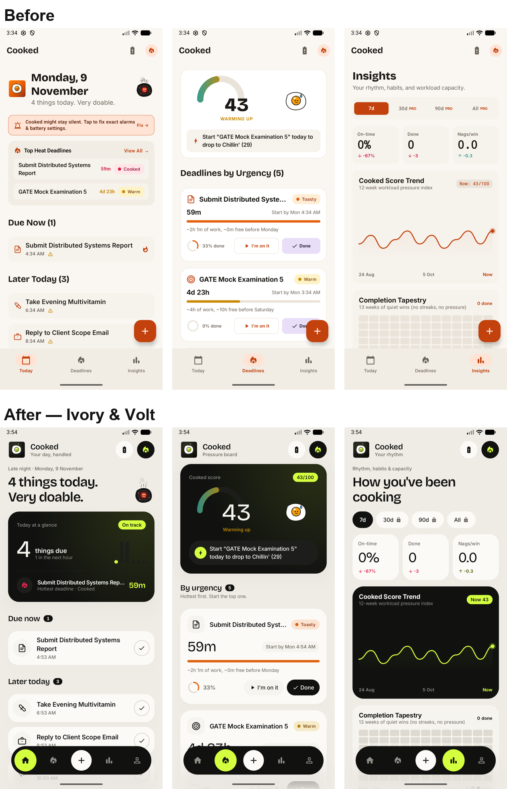
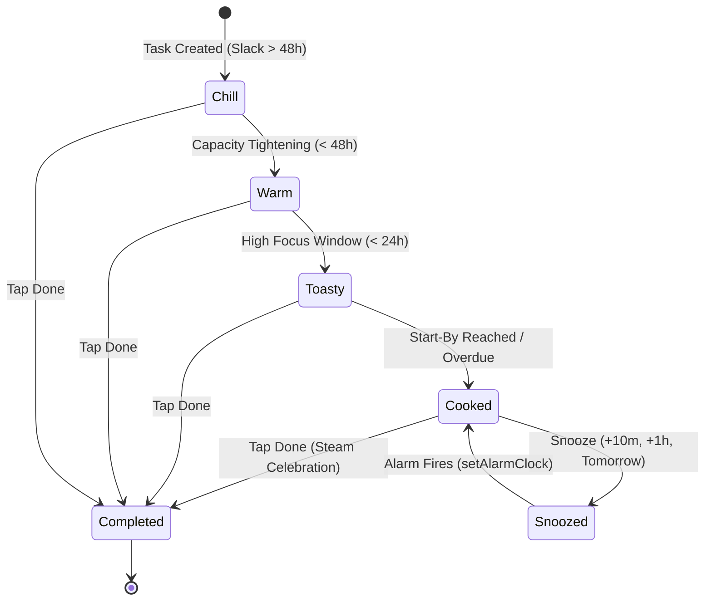
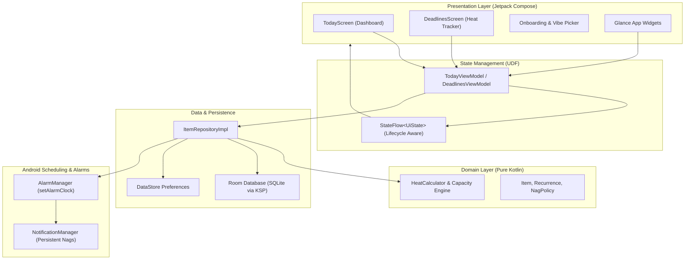
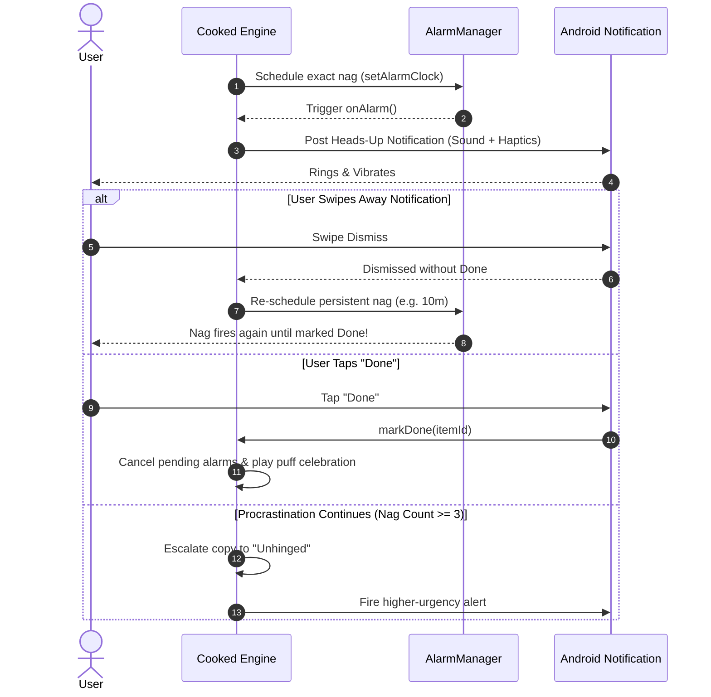
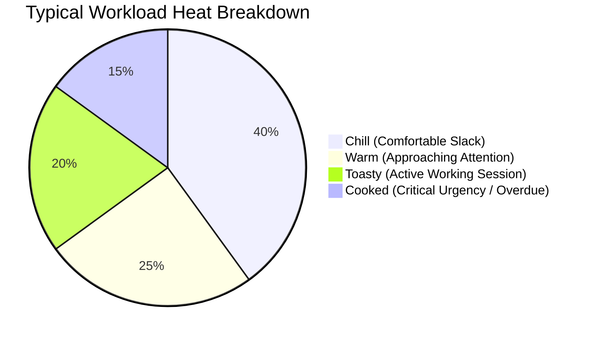

# Cooked 🔥

<p align="center">
  
</p>

<h3 align="center">Your Day, Handled. So You're Not Cooked.</h3>

<p align="center">
  A persistent deadline tracker, accountability companion, and nagging reminder app engineered for college students, freelancers, developers, and ADHD adults.
</p>

<p align="center">
  <a href="https://kotlinlang.org"></a>
  <a href="https://developer.android.com/jetpack/compose"></a>
  <a href="https://developer.android.com/about/versions/15"></a>
  <a href="https://developer.android.com/training/data-storage/room"></a>
  <a href="https://detekt.dev"></a>
  <a href="LICENSE"></a>
</p>

---

## ⚡ What Makes Cooked Different

- **Nag-Until-Done Engine**: Swiping a notification away **never** completes a task. Cooked persistently re-alerts you at configurable intervals until you physically tap **Done**.
- **The Heat Engine**: Deadlines don't sneak up; they heat up. The engine balances your task workload against real waking capacity, grading urgency into **Chill**, **Warm**, **Toasty**, and **Cooked**.
- **Start-By Guidance**: Automatically computes your true "start-by" threshold by subtracting estimated effort and a 24-hour safety buffer from the final due date.
- **Three Accountability Personalities**:
  - *Mild*: Gentle, friendly, supportive nudges.
  - *Spicy*: Sarcastic, playful, and slightly aggressive accountability.
  - *Unhinged*: Chaotic, relentless reminders that will not stop until you get to work.
- **Sub-3-Second Quick Capture**: Natural language parsing converts phrases like *"Submit assignment Friday 5pm"* into structured reminders instantly.
- **Anti-Task-Killer Defense**: Built with `AlarmManager.setAlarmClock()`, surviving aggressive OEM task killers (MIUI/HyperOS, Samsung OneUI, ColorOS).
- **100% Custom Premium Vector Iconography**: Zero generic system emojis; every symbol is a handcrafted, scalable vector SVG.

---

## 📸 Interface Preview

<p align="center">
  
</p>

| Light Mode (Editorial Cream `#F2F0E8`) | Dark Mode (Deep Carbon `#0B0C0A`) |
| :--- | :--- |
| Handcrafted warm cream canvas, pure white task cards, Volt `#C6FF3D` highlights, and high-contrast typography. | Deep OLED black surfaces, elevated borders, and vivid Volt accent glows for late-night focus sessions. |

---

## 📊 System Visualizations & Charts

### 1. Urgency Escalation State Flow
How tasks dynamically heat up as deadlines approach:



### 2. Architecture & Unidirectional Data Flow (UDF)
Clean Architecture with unidirectional state management and offline-first persistence:



### 3. Persistent Nagging Lifecycle
What happens when you ignore or dismiss a reminder:



### 4. Typical Workload Heat Distribution



---

## 🛠️ Tech Stack & Libraries

| Layer | Technologies |
| :--- | :--- |
| **Language** | [Kotlin 2.2](https://kotlinlang.org) (Coroutines, Flow, Serialization) |
| **UI & Design** | [Jetpack Compose](https://developer.android.com/jetpack/compose), Material 3, Custom Design System (`CookedTheme`), Vico Charts |
| **Architecture** | Clean Architecture, MVVM, Unidirectional Data Flow (UDF) |
| **Persistence** | [Room 2.7+](https://developer.android.com/training/data-storage/room) (KSP), AndroidX DataStore Preferences |
| **Scheduling** | `AlarmManager.setAlarmClock()`, AndroidX WorkManager, BroadcastReceivers |
| **Widgets** | Jetpack Glance (`GlanceAppWidget`), Quick Settings `TileService` |
| **Dependency Injection** | [Dagger Hilt](https://dagger.dev/hilt/) 2.55+ |
| **Quality & Tests** | Detekt, JUnit 4, Robolectric, Turbine, Truth |

---

## 🎨 Design System Palette

```
Light Mode (Warm Cream):
  Background:       #F2F0E8
  Card Surface:     #FFFFFF
  Hero Container:   #11120F
  Volt Accent:      #C6FF3D
  Overdue Urgency:  #B34855
  Border Stroke:    #E1DFD5

Dark Mode (Deep Carbon):
  Background:       #0B0C0A
  Card Surface:     #141512
  Elevated Surface: #22241E
  Volt Accent:      #C6FF3D
  Overdue Urgency:  #FF5C5C
  Border Stroke:    #262820
```

---

## 🚀 How to Build & Run

### Prerequisites
- **JDK**: Version 17 or higher
- **Android SDK**: `compileSdk 35`, `minSdk 26`
- **Gradle**: 9.5+ (Wrapper included)

### Commands
```bash
# 1. Run Unit Tests & View State Assertions
./gradlew testDebugUnitTest

# 2. Run Android Lint Checks
./gradlew lintDebug

# 3. Run Detekt Static Analysis
./gradlew detekt

# 4. Assemble Debug APK
./gradlew assembleDebug

# 5. Assemble Release APK (R8 Minified)
./gradlew assembleRelease
```

Generated APKs are located at:
- Debug: `app/build/outputs/apk/debug/app-debug.apk`
- Release: `app/build/outputs/apk/release/app-release.apk`

---

## 🔒 Privacy & Local-First Guarantee

- **100% Offline-First**: Your tasks, schedules, and notes are stored strictly on your device inside local SQLite storage.
- **Zero Account Wall**: Use Cooked immediately without forced logins, email harvesting, or trackers.
- **Zero Cloud Leakage**: Alarms, deadlines, and notifications are processed entirely on-device via native Android scheduling APIs.

---

## 📄 Documentation Links

- [Architecture Guide](docs/ARCHITECTURE.md)
- [Design Review & UI System](docs/DESIGN_REVIEW.md)
- [Brand Voice & Copy Guidelines](docs/COPY.md)
- [Accessibility & Performance Guide](docs/ACCESSIBILITY_AND_PERFORMANCE.md)
- [Play Store Listing Details](docs/STORE_LISTING.md)
- [Privacy Policy](docs/PRIVACY_POLICY.md)

---

## 📜 License

Cooked is open-source software licensed under the **[MIT License](LICENSE)**.  
Copyright © 2026 Md Kasif Uddin. All rights reserved.
